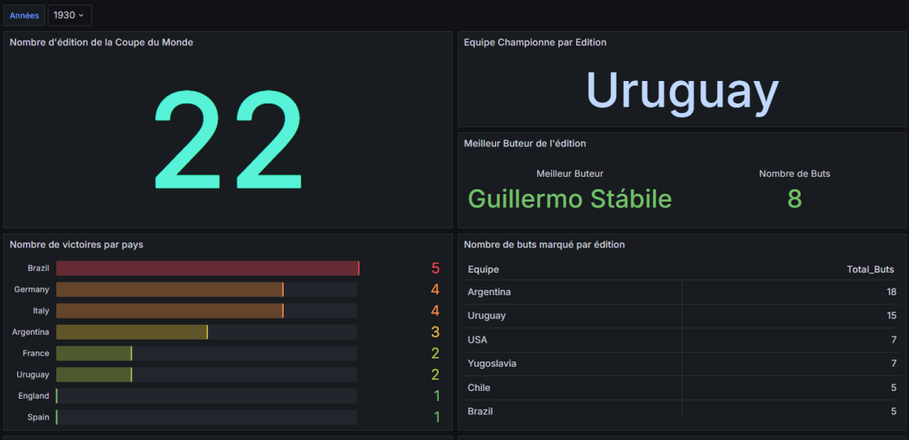
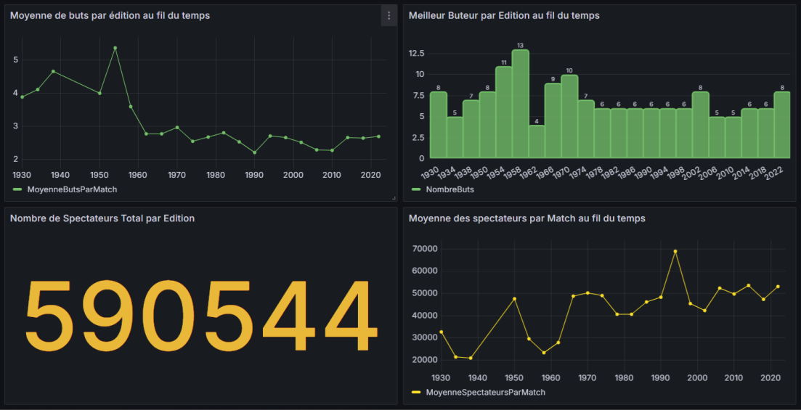

# FIFA World Cup — Historical Analysis (1930–2022)

> University team project · BUT Informatique (Bachelor's degree in Computer Science), data specialisation · IUT d'Amiens
> Tools: **Dataiku** (data preparation and joins) · **Grafana** (dashboard)

## Business question

> Which key indicators best explain how the World Cup has evolved, its highlights, and the growing interest it attracts over the editions?

## Data

Public datasets from Kaggle covering the 22 editions from 1930 to 2022:

| Dataset | Content |
| --- | --- |
| Players | Goal scorers per edition |
| Teams | Participating nations, winners |
| Matches | Results and goals per match |
| Attendance | Spectators per match and per edition |

## Approach

1. **Data collection** — selected the Kaggle datasets that could answer the business question.
2. **Cleaning** (Dataiku) — handled missing values and harmonised obsolete entries, for example merging *West Germany* and *East Germany* into *Germany* so that historical results are comparable.
3. **Joins** (Dataiku) — joined the datasets into a single analysis table (goals, attendance, results, teams).
4. **Dashboard** (Grafana) — exported the table and built a dashboard around 9 KPIs, with a filter by edition.

## The 9 KPIs

| # | KPI | Key finding |
| --- | --- | --- |
| 1 | Number of editions | 22 editions since 1930, despite the interruption during World War II |
| 2 | Champion per edition | A few nations dominate: Brazil won in 1958, 1962, 1970, 1994 and 2002 |
| 3 | Top scorer per edition | Just Fontaine still holds the record with 13 goals in 1958 |
| 4 | Titles per country | Brazil leads with 5 titles, ahead of Germany and Italy with 4 each |
| 5 | Goals per team and edition | In 1930, Argentina (18 goals) and Uruguay (15) were by far the most offensive teams |
| 6 | Average goals per match over time | Above 4 goals per match in the early editions (peak at 5.4 in 1954), then stable around 2.5 to 3 since the 1960s |
| 7 | Top scorer's goals over time | Individual records peaked in the 1950s; recent top scorers score 5 to 8 goals |
| 8 | Total attendance per edition | Recent editions exceed 3 million spectators, with a record of 3.5 million in 1994 (USA) |
| 9 | Average attendance per match | Peak at about 68,000 spectators per match in 1994 |

## My contribution

This was a team project. My personal role:

- **Chose the datasets** and checked that they could answer the business question
- **Defined all 9 KPIs**
- **Cleaned the data** in Dataiku (missing values, harmonised country names)
- **Built the joins** between the datasets in Dataiku
- **Built part of the Grafana dashboard** and led the choice of visualisations

## Limitations and next steps

- The dashboard mixes fixed indicators (all editions) and indicators driven by the edition filter: a clearer split between the two would make it easier to read.
- Attendance figures depend on the source dataset and may differ from official FIFA figures.
- Next step: build a custom dataset on rule changes in football (offside rule, number of teams, extra time) to measure their impact on goals and results.

## Repository content

| Path | Content |
| --- | --- |
| `images/` | Screenshots of the Grafana dashboard |

The Dataiku flow and the Grafana instance were hosted in the university environment and are not included in this repository.

---

**Furkan Mutlu** · Junior Data Analyst · [github.com/Furkan-Mtl](https://github.com/Furkan-Mtl)
